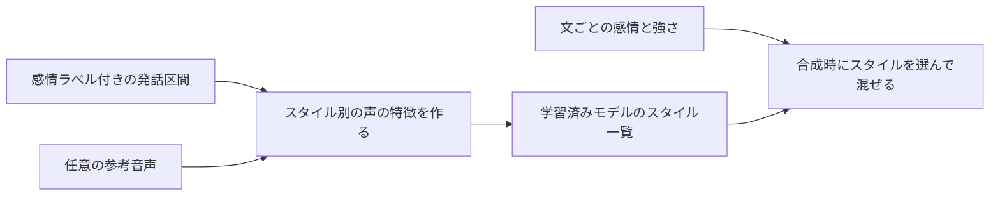

# 感情による声の切り替え(トーク・歌唱)の設計

- 目的: 発話では感情に応じて声を変え、歌唱でも感情表現を付けられるようにする。どちらも「使わない」を選べ、使わないときは今の結果と変えない
- 状態: 設計(未実装)。実モデル・実音声での効果は未確認
- 最終確認日: 2026-11-08
- 関連: [質感プリセットの分類](texture-preset-taxonomy.md) / [学習システム設計](learning-system-design.md) / `docs/future-format.md`

## 要点

- 感情は質感とは別の軸にします。質感は「どんな声か」、感情は「その瞬間にどう言う・歌うか」です。
- 既定は「指定なし」です。指定なしのときの生成結果は、この機能が無い場合と同じにします。
- 非対応の方式では、感情の指定を無言で無視せず「この方式では感情を変えられません」と表示します。
- 感情ラベルが付いていない素材は、勝手に「平常」と決めず「ラベルなし」として扱います。

## 用語

| 用語 | 意味 |
| --- | --- |
| 感情 | 平常・喜び・怒り・悲しみ・驚きなど、利用者が選ぶ表現の名前(固定リストにせず利用者が追加できる) |
| 強さ | 0〜1の数値。0は感情なし、1は最大 |
| 感情ラベル | 素材の区間に付ける感情の名前。付ける人(利用者/推定)と確信度を持つ |

## トーク(発話)

1. 学習時: ラベルが十分ある感情ごとに、Style-Bert-VITS2 のスタイルベクトルを作る。ラベル付き区間が少ない感情は、作らずに理由を表示する(最小件数は実測で決める。未決)。
2. 参考音声から作る: 参考音声(別設計の「任意の参考音声」)を感情の手本として登録できる。この場合も教師データにはしない。
3. 合成時: 文(または区間)ごとに「感情+強さ」を指定すると、該当スタイルとの混合比に変える。指定なしの文は従来どおり。
4. 感情の名前が未登録なら、近い別の感情へ置き換えず、合成を止めて理由を示す。

## 歌唱

1. 歌唱の感情は、DiffSinger の声量・息成分・強弱などの変化曲線(variance)で表す。感情の1語は、これら曲線の組(プリセット)に対応させる。
2. 利用者はフレーズ(または音符)ごとに感情と強さを付けられる。強さ0または未指定のときは曲線に触れない。
3. 学習側にその曲線を持つモデルがあるときだけ有効にする。無ければ「このモデルは感情表現の曲線を持たないため使えません」と表示する。
4. プリセットの中身(どの曲線をどれだけ動かすか)は実音声の聴き比べで決める。今は仮置きの値を作らない。

## データ

- 区間(`UniversalVoiceSegment`)に任意項目 `emotion`(名前・付けた主体 user/inferred・確信度)を足す。既存データは項目なしで読め、結果を変えない。
- 推定したラベルは「推定」と明記し、利用者が直せる。推定の確信度が未測定なら 0% と見せず「未測定」と表示する。
- 学習に使うかは用途別の適格性・重みの仕組みに乗せ、感情ラベルだけを理由に区間を除外しない。

## 画面

- 学習計画: 「感情表現を使う/使わない」を最初は「使わない」にする。使う場合に、感情ごとの素材件数と、作れない感情の理由を表示する。
- 合成・編集: 文/フレーズごとに感情と強さを選ぶ。選択肢は、そのモデルが対応する感情だけを出す。

## 検証と安全

- 「指定なし」で従来と同一の結果になること(音声のハッシュ比較)をテストで確認する。
- 感情ごとの試験音声を学習後の検証(`verification.json`)に載せ、試聴できるようにする。実聴の評価は利用者が行う。
- 推定した感情は本人の内心を示すものではなく、声の表現の分類である旨を表示に添える。

## 実装の分け方(提案)

| 順 | 内容 | 依存 |
| --- | --- | --- |
| 1 | 区間の感情ラベル項目と保存、既存データの互換テスト | なし |
| 2 | ラベル付与の画面(利用者が付ける。推定は後) | 1 |
| 3 | トークのスタイル別ベクトル作成と合成時の混合 | 1・参考音声 |
| 4 | 歌唱のフレーズ単位の感情プリセットと variance 曲線 | DiffSinger の variance 学習 |
| 5 | 感情の推定(任意) | 1 |

## 未決事項

- スタイルを作るのに必要なラベル付き区間の最小件数と長さ(実測が必要)。
- 感情プリセットの曲線の値(聴き比べで決める)。
- 歌唱の variance モデルを学習する経路が現状どこまであるか(未確認)。

## 実装状況

- 実装済み(手順1の一部): 区間(`UniversalVoiceSegment`)に任意の `Emotion`(`EmotionLabelRecord`: 名前・付け手 user/inferred・確信度)を追加した。未設定(null)のときは保存結果に出さず、既存データと同じ形で読み書きできる。`Validate()` が、空・前後の空白・制御文字・33文字以上の名前、user/inferred 以外の付け手、0〜1の範囲外や非有限の確信度、利用者ラベルへの確信度を日本語の理由つきで断る。
- 未実装: 保存経路(既存の上書き記録への接続)、ラベルを付ける画面、学習・合成への反映、推定。
